<div align="center">

# Jayant Systems

**You run the business. We handle the digital.**

The website and back office of **Jayant Systems** — a founder-led digital studio in New Delhi building websites, custom software, AI automation, design and growth for businesses.

[**Live site →**](https://jayant-systems.online) &nbsp;·&nbsp; [Design system](DESIGN.md) &nbsp;·&nbsp; [Runbook](MAINTENANCE_RUNBOOK.md) &nbsp;·&nbsp; [Security plan](SECURITY_INCIDENT_RESPONSE_PLAN.md)

[](https://github.com/JayantOlhyan/Jayant-solutions/actions/workflows/ci.yml)


<br/>

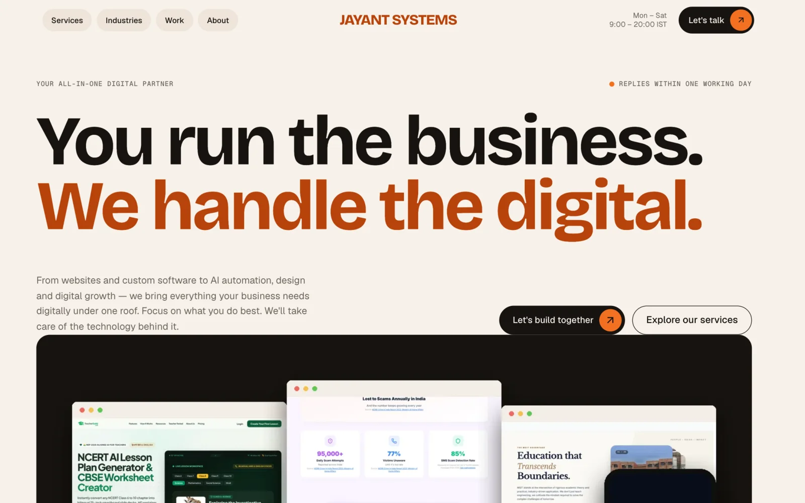

</div>

---

## Contents

- [What this is](#what-this-is)
- [A tour of the site](#a-tour-of-the-site)
- [Features](#features)
- [Design system](#design-system)
- [Architecture](#architecture)
- [Tech stack](#tech-stack)
- [Getting started](#getting-started)
- [Environment variables](#environment-variables)
- [Project structure](#project-structure)
- [Database](#database)
- [API](#api)
- [Quality gates & CI](#quality-gates--ci)
- [Deployment](#deployment)
- [Documentation](#documentation)

---

## What this is

One Next.js application that does two jobs:

1. **The public studio website** — services, industries, work, process, pricing and contact, built in a warm *paper / ink / flame* identity with scroll-driven motion.
2. **The studio's back office** — an admin dashboard and sales cockpit, token-based client proposals with negotiation, digital agreements, invoices, Razorpay payments, kickoff booking and onboarding, all on Supabase with row-level security.

No third-party CRM, proposal or invoicing tool is involved: the whole client lifecycle, from first enquiry to paid invoice, lives in this repository.

---

## A tour of the site

### The homepage reads like a story

A scroll-read statement, a winding "journey" through the process, and live product previews instead of stock imagery.

<table>
  <tr>
    <td width="50%">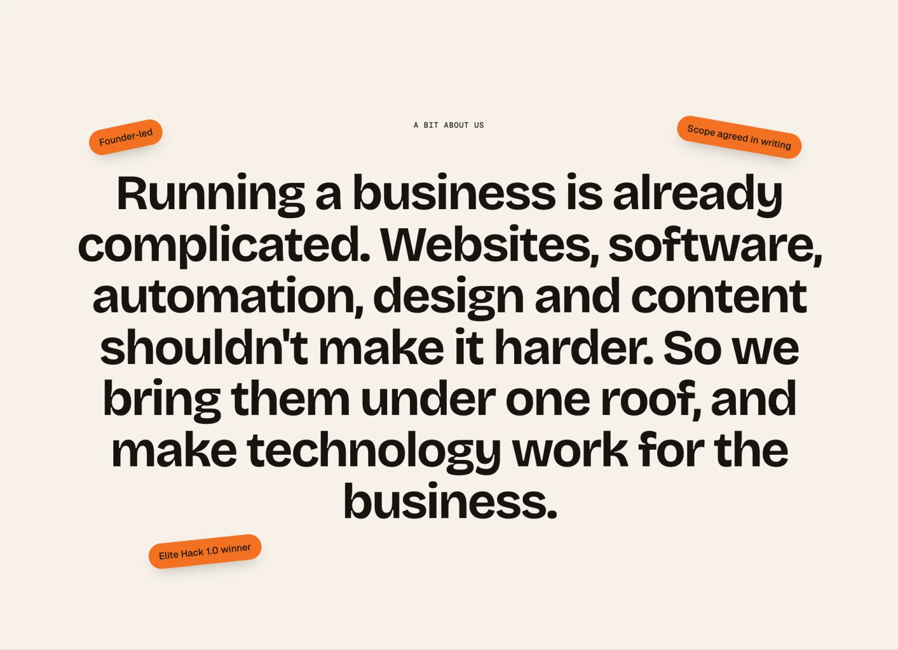</td>
    <td width="50%">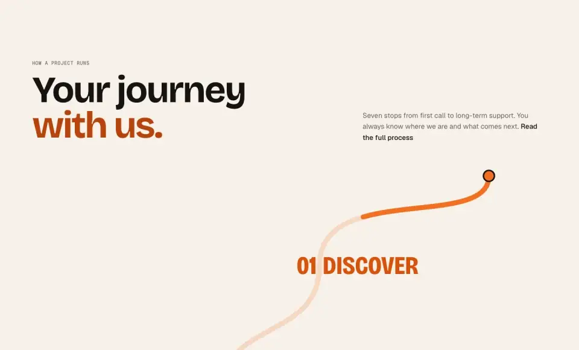</td>
  </tr>
  <tr>
    <td><b>"A bit about us"</b> — as you scroll, an orange reading wave moves through the letters (pale → flame → ink), and sticker chips drop on with a bounce.</td>
    <td><b>"Your journey with us"</b> — the seven process steps on a scroll-drawn line. Each icon opens between its number and name as the line arrives; captions pop in and everything reverses on scroll-up.</td>
  </tr>
</table>

<details>
<summary><b>See the full journey section</b> (all seven stops)</summary>
<br/>
<p align="center">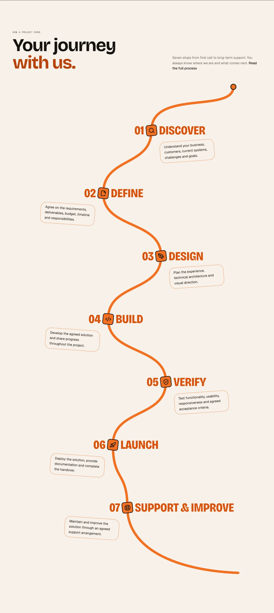</p>
</details>

### Footers

<table>
  <tr>
    <td width="50%">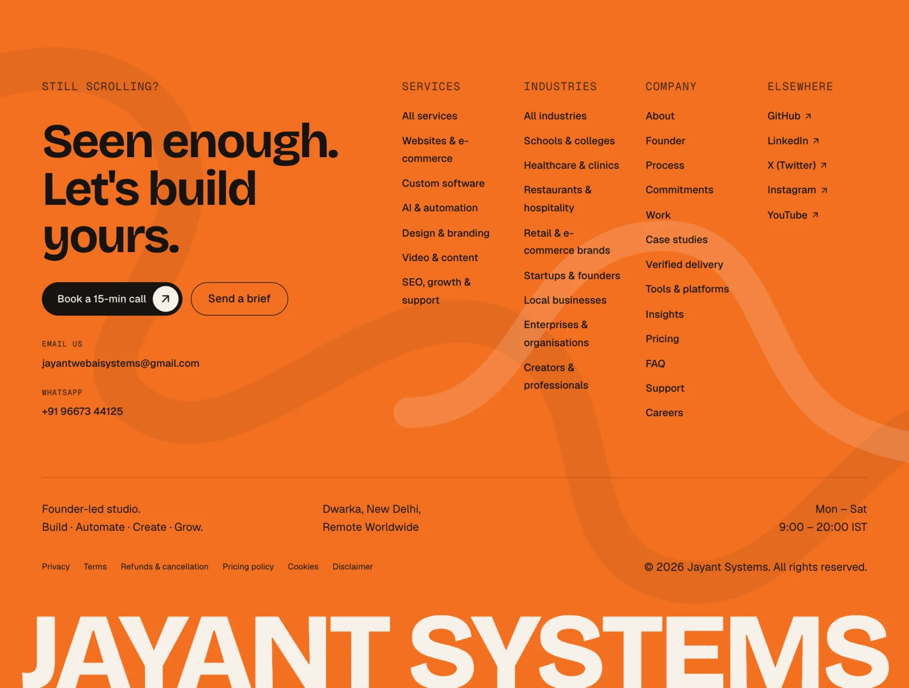</td>
    <td width="50%">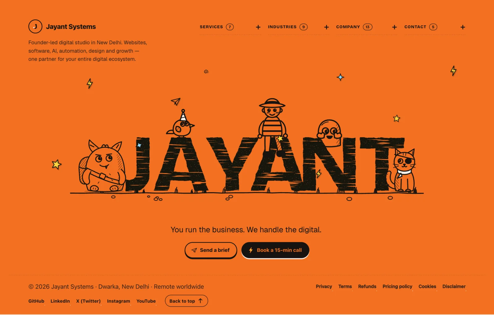</td>
  </tr>
  <tr>
    <td><b>Site footer</b> — flame field, ink type (6.3:1 contrast), every link one click away, edge-to-edge wordmark.</td>
    <td><b>Founder page footer</b> — a full-screen, hand-drawn "doodle crew": letters stamp in, eyes follow the cursor, click a character to hear its line. Link groups collapse so the scene fits one screen.</td>
  </tr>
</table>

### Conversion pages

<table>
  <tr>
    <td width="50%">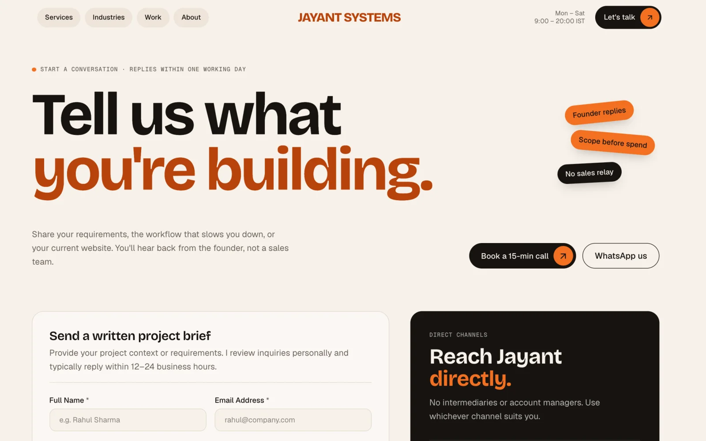</td>
    <td width="50%">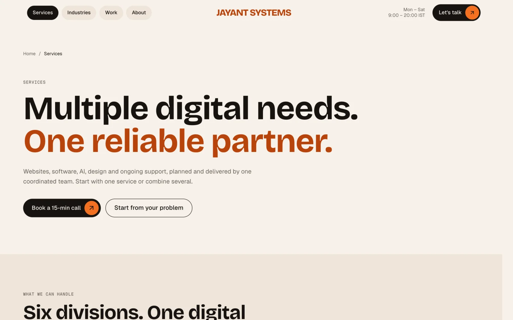</td>
  </tr>
  <tr>
    <td><b>Contact</b> — a short project-brief form (four required fields), a 15-minute Cal.com call, WhatsApp, and a direct-channels card. The founder replies personally.</td>
    <td><b>Services</b> — six divisions, each with its own page, plus an entry point that starts from the visitor's problem rather than our service list.</td>
  </tr>
</table>

<p align="center">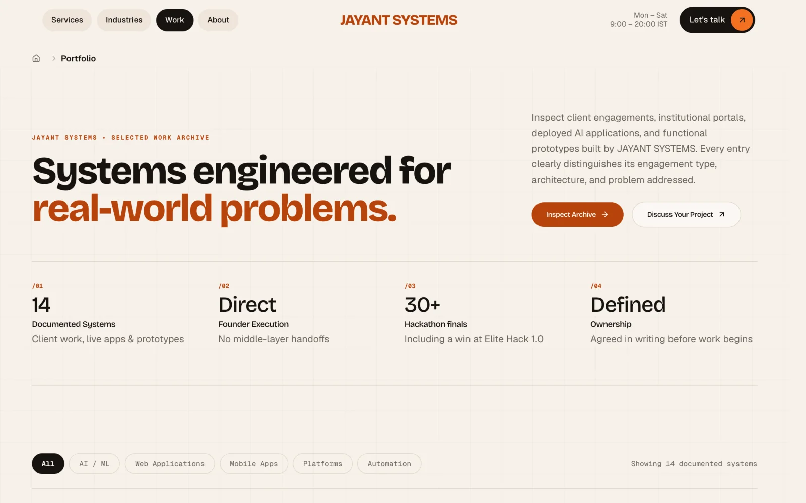</p>

### On a phone

<table>
  <tr>
    <td width="33%" align="center">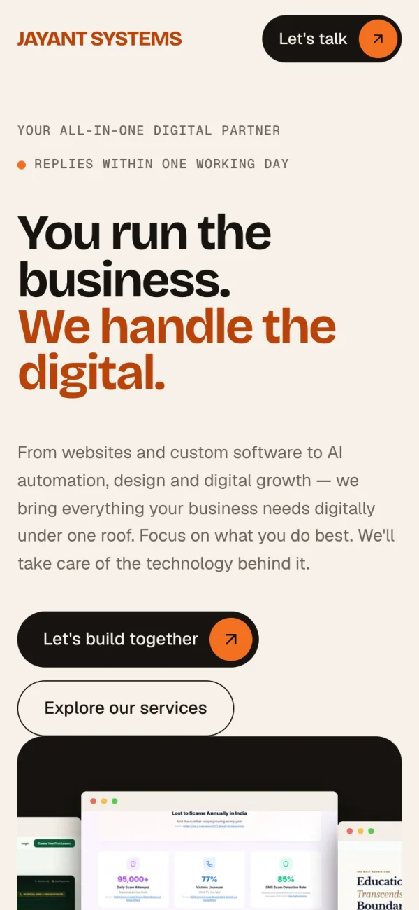</td>
    <td width="33%" align="center">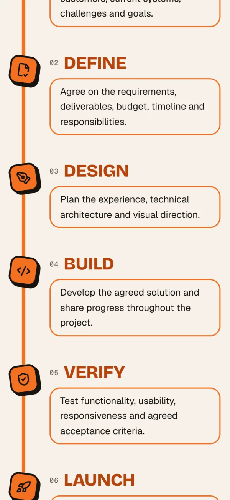</td>
    <td width="33%" align="center">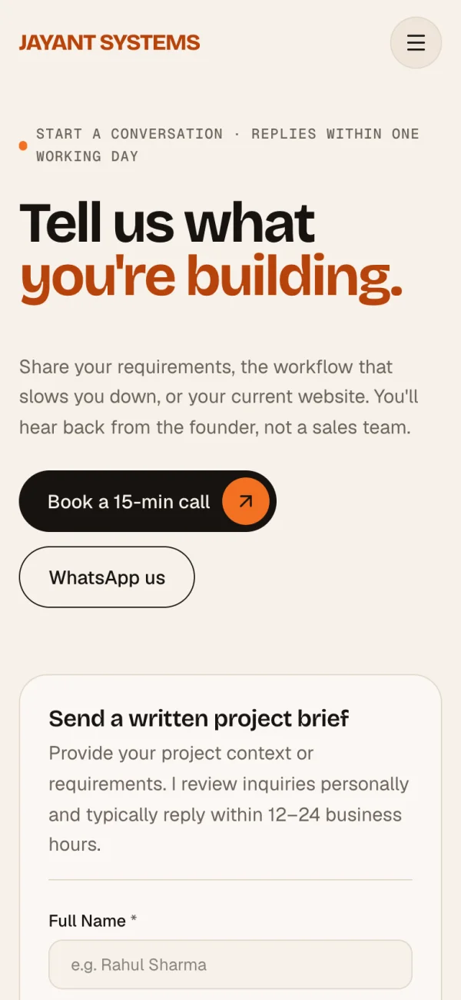</td>
  </tr>
  <tr>
    <td align="center">Homepage</td>
    <td align="center">Journey becomes a straight rail</td>
    <td align="center">Contact</td>
  </tr>
</table>

---

## Features

### Public website
- **Studio identity** — paper `#F7F1EA`, ink `#161310`, flame `#F37021`; Bricolage Grotesque headlines with Geist and Geist Mono. One header grammar across every page (pill nav · centred wordmark · hours + "Let's talk").
- **Motion that rewards scrolling** — GSAP ScrollTrigger + Lenis: preloader, curved service ribbon, scroll-read statement, scroll-drawn process journey, looping product videos that pause off-screen.
- **Accessible by default** — WCAG AA contrast on every text colour, visible focus rings, keyboard-operable menus and accordions, 44px touch targets, and a full `prefers-reduced-motion` path where every section renders in its finished state.
- **Content structure** — six service divisions with sub-service pages, industry pages, portfolio, case studies, process, pricing, FAQ, company pages, blog, and legal pages; 106 statically generated pages.
- **SEO** — per-page metadata and canonicals, JSON-LD (Organization, WebSite), sitemap, robots, generated Open Graph / Twitter images, and `llms.txt` for AI crawlers.
- **PWA-ready** — service worker with a branded offline page; an offline notice that only appears after a *confirmed* outage.

### Getting in touch
- **Project brief form** — four required fields; optional details tucked into a disclosure; inline accessible validation; duplicate-submit protection; 10-second timeout with WhatsApp / email fallbacks that keep what the visitor typed. Delivered through Netlify Forms.
- **15-minute discovery call** — embedded Cal.com scheduler with load-timeout recovery and a direct link.
- **Direct channels** — email, WhatsApp and phone from one shared config (`src/data/contact.ts`).

### Back office
- **Admin sign-in with MFA** — Supabase auth with TOTP enrolment, challenge/verify and account recovery.
- **Dashboard & India sales cockpit** — pipeline stats, CSV export, audit logs and role assignment ([docs](docs/india-sales-cockpit.md)).
- **Client lifecycle** — token-based proposals → package selection → negotiation (with admin override) → digital agreement (sign / decline) → invoice (`INV-YYYY-XXXX`, PDF download) → Razorpay payment links and refunds → kickoff booking → onboarding review.
- **Signature-verified webhooks** — Razorpay and Cal.com events, plus Resend delivery events.
- **Privacy** — self-service data export and erasure endpoints.
- **Monitoring** — Sentry on client, server and edge; a `/api/health` check.

---

## Design system

The full spec lives in **[DESIGN.md](DESIGN.md)** (tokens, type scale, components, motion rules, changelog).

| Token | Hex | Used for |
|---|---|---|
| `paper` | `#F7F1EA` | Page background |
| `ink` | `#161310` | Text, dark sections, primary buttons |
| `flame` | `#F37021` | Brand fills — ribbon, stickers, CTA dot, footer |
| `flame-ink` | `#B8430A` | Orange **text** on paper (4.87:1) |
| `sand` | `#EFE5DA` | Alternate sections, pills, inputs |

**Type:** Bricolage Grotesque (display, with its width axis for condensed titles) · Geist (body) · Geist Mono (labels) — all self-hosted through `next/font`.

---

## Architecture

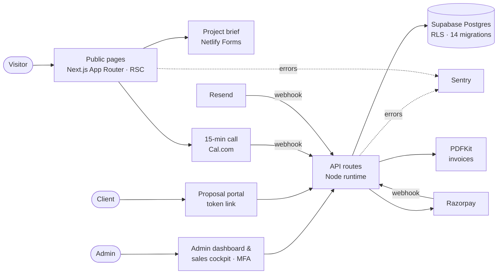

---

## Tech stack

| Area | Choice |
|---|---|
| Framework | **Next.js 16** (App Router, Server Components), **React 19** |
| Language | **TypeScript 7** for `tsc`; the TS 6 API (`@typescript/typescript6`) is aliased as `typescript` for ESLint and Next's build type-check |
| Styling | **Tailwind CSS 4**, design tokens in `src/app/globals.css` |
| Motion | **GSAP 3** (ScrollTrigger, SplitText), **Lenis** smooth scroll, Framer Motion |
| Data & auth | **Supabase** (Postgres, RLS, SSR auth), **Zod** validation |
| Payments | **Razorpay** (payment links, refunds, webhooks) |
| Scheduling / email | **Cal.com**, **Resend** |
| Documents | **PDFKit** |
| Observability | **Sentry**, Google Analytics |
| Hosting | **Netlify** (security headers + CSP in `netlify.toml`) |

---

## Getting started

**Prerequisites:** Node.js 22 (what CI uses), npm, and a Supabase project for the back office. The public site runs without any secrets.

```bash
git clone https://github.com/JayantOlhyan/Jayant-solutions.git
cd Jayant-solutions
npm ci
cp .env.example .env.local   # then fill in the values below
npm run dev                  # http://localhost:3000
```

| Script | What it does |
|---|---|
| `npm run dev` | Start the dev server |
| `npm run build` | Production build (type-checks and prerenders all pages) |
| `npm run start` | Serve the production build |
| `npm run lint` | ESLint (fails on errors) |
| `npm run test:inquiry` | Contact-form logic tests (validation, payload, fallbacks, timeout) |
| `npm run test:sales` | Sales cockpit model + database tests |
| `npm run llms` | Regenerate `public/llms.txt` |

Type-check on its own with `npx tsc --noEmit` (TypeScript 7).

---

## Environment variables

Copy `.env.example` to `.env.local`. **Never expose server-only keys to the browser.**

| Variable | Scope | Purpose |
|---|---|---|
| `NEXT_PUBLIC_APP_URL` | public | Base URL used in links and webhooks |
| `NEXT_PUBLIC_SUPABASE_URL` | public | Supabase project URL |
| `NEXT_PUBLIC_SUPABASE_ANON_KEY` | public | Supabase anon key |
| `SUPABASE_SERVICE_ROLE_KEY` | **server** | Admin database access |
| `ADMIN_EMAIL` | server | Admin notifications |
| `RAZORPAY_KEY_ID` / `RAZORPAY_KEY_SECRET` | **server** | Razorpay API |
| `RAZORPAY_WEBHOOK_SECRET` | **server** | Verifies Razorpay webhooks |
| `CAL_WEBHOOK_SECRET` | **server** | Verifies Cal.com webhooks |
| `RESEND_API_KEY` / `RESEND_WEBHOOK_SECRET` / `EMAIL_FROM` | **server** | Transactional email |
| `NEXT_PUBLIC_SENTRY_DSN` / `SENTRY_DSN` | public / server | Error tracking |
| `SENTRY_ORG` / `SENTRY_PROJECT` | build | Source-map upload |
| `NEXT_PUBLIC_GA_MEASUREMENT_ID` | public | Google Analytics |
| `SHOW_UNCONFIRMED` | build | Show service offerings not yet confirmed (off in production) |

---

## Project structure

```text
src/
├── app/                      # App Router: pages, layouts, API routes
│   ├── page.tsx              # Homepage (studio direction)
│   ├── services/ industries/ portfolio/ company/ contact/ …
│   ├── admin/                # Dashboard, sales cockpit, login, password reset
│   ├── api/                  # 39 route handlers (see API)
│   └── globals.css           # Tokens + studio styles
├── components/
│   ├── studio/               # Homepage sections + StudioMotion (GSAP)
│   ├── v2/                   # Site header, footers, shared primitives
│   ├── framework/            # Page template blocks for inner pages
│   └── ui/                   # Reusable UI (doodle-crew footer, …)
├── data/                     # framework.ts (all copy), contact.ts
└── lib/                      # inquiry logic, payments, notifications, seo, rate limiting
supabase/migrations/          # 00001 → 00014
tests/                        # inquiry + sales tests (node:test via tsx)
docs/                         # phase handoffs, sales cockpit, README media
```

---

## Database

Fourteen ordered migrations in `supabase/migrations/` build the schema, RLS policies and hardening — from `00001_foundation.sql` to `00014_india_sales_cockpit.sql`.

Core tables: `admin_users`, `clients`, `packages`, `proposals`, `negotiations`, `commercial_terms`, `agreements`, `invoices`, `payments`, `payment_events` (webhook idempotency), `bookings`, `onboarding`, plus the sales cockpit tables.

```bash
supabase link --project-ref <your-project-ref>
supabase db push
```

Clients never get passwords: they reach their proposal through an unguessable token link, and RLS limits every query to that token.

---

## API

| Group | Routes |
|---|---|
| **Auth** | `login`, `logout`, `mfa/{enroll,challenge,verify,status,unenroll}`, `recovery/{request,confirm}` |
| **Admin** | `dashboard/stats`, `sales`, `export`, `audit-logs`, `roles/assign`, `proposals/timeline`, `negotiations/override`, `agreements/create`, `invoices`, `payments/refund`, `onboarding/review` |
| **Client journey** | `proposal/[slug]`, `proposal/select-package`, `proposal/negotiate`, `agreement/{sign,decline}`, `invoice/[id]/download`, `payments/{create-link,verify}`, `kickoff/book`, `onboarding/{status,submit}` |
| **Webhooks** | `webhooks/razorpay`, `webhooks/cal`, `webhooks/resend` |
| **Privacy & health** | `privacy/{export,erasure}`, `health` |

All routes live under `src/app/api/` and are rate-limited where public (`src/lib/rate-limit.ts`).

---

## Quality gates & CI

Every push and pull request to `main` runs [`.github/workflows/ci.yml`](.github/workflows/ci.yml):

1. `npm ci`
2. **Typecheck** — `tsc --noEmit` (TypeScript 7)
3. **ESLint** — fails on errors
4. **Sales cockpit tests**
5. **Dependency audit** (reported, non-blocking)
6. **Production build** — all pages prerendered
7. Regression script

Before release, pages are also checked in a real browser at 390, 768, 1024, 1440 and 1920 px (no horizontal overflow, keyboard paths, reduced motion). The release protocol is in [`docs/phase-7-release.md`](docs/phase-7-release.md).

---

## Deployment

Deployed on **Netlify** from `main` to **[jayant-systems.online](https://jayant-systems.online)**.

1. Connect the repository in Netlify.
2. Add the environment variables above.
3. Pushes to `main` deploy; pull requests get deploy previews.

`netlify.toml` sets HSTS, frame, referrer and permissions headers and a Content-Security-Policy that allows only Supabase, Razorpay, Cal.com and Sentry.

---

## Documentation

| Document | What's in it |
|---|---|
| [DESIGN.md](DESIGN.md) | Brand foundation: tokens, type, components, motion, changelog |
| [MAINTENANCE_RUNBOOK.md](MAINTENANCE_RUNBOOK.md) | Day-to-day operations |
| [SECURITY_INCIDENT_RESPONSE_PLAN.md](SECURITY_INCIDENT_RESPONSE_PLAN.md) | What to do when something goes wrong |
| [docs/india-sales-cockpit.md](docs/india-sales-cockpit.md) | Sales cockpit model and data |
| [docs/phase-7-release.md](docs/phase-7-release.md) | Release verification and launch gates |
| [DEV_LOG.md](DEV_LOG.md) | Development history |

<div align="center">
<br/>

**Jayant Systems** · Dwarka, New Delhi · Remote worldwide
[jayant-systems.online](https://jayant-systems.online) · [LinkedIn](https://linkedin.com/company/jayant-systems) · [GitHub](https://github.com/JayantOlhyan)

<sub>Screenshots in <code>docs/readme/</code> are captured from the running site.</sub>

</div>
