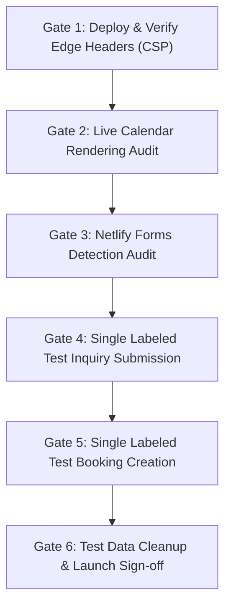

# Phase 7: Final Release Verification & Controlled Launch Protocol

**Date:** November 8, 2026  
**Repository:** `/Users/jayantolhyan/Desktop/my projects/portfolio Website/portfolio for agency/`  
**Current Branch:** `redesign/phase-1-foundations`  
**Base Commit:** `de6ad4b`  
**Production Target:** `https://jayant-systems.online`  
**Current Status:** **READY FOR CONTROLLED LAUNCH (UNRELEASED / PENDING PRODUCTION GATES)**  

---

## 1. Executive Summary & Release Scope

Phase 7 represents the final release readiness audit, automated browser verification, and controlled launch runbook for the agency portfolio redesign.

The release scope is strictly confined to:
1. **Homepage (`/`):** Founder-led value proposition, early visible "Book a call" and "Send an inquiry" actions, verified capabilities proof row, 3 core project case studies with WebP assets, 3-group service offering, 4-stage process, transparent FAQ accordion, and direct contact brief.
2. **Contact Page (`/contact`):** Friction-free project inquiry form with accessible validation, inline error reporting, synchronous submission lock, offline/network failure recovery with direct WhatsApp/Email brief generation, and direct Cal.com booking link.
3. **Dedicated Booking Page (`/contact/book-a-consultation`):** Resilient Cal.com scheduling embed with `loading="eager"`, bounded 12-second loading timeout, generation-attempt isolation preventing stale callback interference, persistent external calendar fallback, and WhatsApp quick-booking.
4. **Security & Deployment Infrastructure:** Synchronized Content Security Policy (CSP) across `next.config.ts` and `netlify.toml`, Netlify forms registration via `public/__forms.html`, and decoupled canonical links to eliminate soft-404 metadata inheritance.

All other systems (administrative portal, Supabase database, proposal negotiation, sales cockpit, and payment links) remain intact and untouched.

---

## 2. Release Candidate Audit & Hardening

### A. Synchronous Submission Lock (`src/components/ContactForm.tsx`)
- **Vulnerability Identified:** In React 19, `setSending(true)` updates state asynchronously. Rapid consecutive click events (e.g. double or triple clicking a submit button) could fire multiple fetch calls before the button's `disabled={sending}` attribute took effect.
- **Remediation:** Introduced `isSubmittingRef = useRef(false)`. At the synchronous entry point of `handleSubmit`:
  ```typescript
  if (isSubmittingRef.current || sending) return;
  isSubmittingRef.current = true;
  setSending(true);
  try {
    const result = await submitInquiry(formData, { honeypot });
    // ... handle success or error
  } finally {
    isSubmittingRef.current = false;
    setSending(false);
  }
  ```
- **Verification:** Tested via Chrome DevTools Protocol (CDP) under rapid synchronous triple-clicks. Confirmed `fetchCount === 1`.

### B. W3C CSP Policy Synchronization (`netlify.toml` & `next.config.ts`)
- **Vulnerability Identified:** Under the W3C Content Security Policy Level 3 specification, if both edge server headers (`netlify.toml`) and application headers (`next.config.ts`) emit a `Content-Security-Policy`, modern browsers compute the strict intersection (logical AND). The previous `netlify.toml` omitted `frame-src`, causing edge requests to block Cal.com embeds.
- **Remediation:** Synchronized `frame-src 'self' https://api.razorpay.com https://cal.com;` and `connect-src` across both configuration files.
- **Security Assessment:**
  - `unsafe-eval` is NOT permitted in the public CSP.
  - Third-party iframe embeds are strictly restricted to `api.razorpay.com` and `cal.com`.
  - No wildcards (`*`) are used for script or connect origins.

### C. Calendar Generation Attempt Isolation (`src/app/contact/book-a-consultation/page.tsx`)
- Iframe loading mode configured as `loading="eager"` to match the 12-second mount timeout.
- Both timeout callbacks and `iframe onLoad` handlers compare against `activeAttemptRef.current`. Stale load events from superseded attempts cannot clear newer timers or alter the UI state.
- Always-visible external booking link (`https://cal.com/jayant-web-and-ai-systems/strategy-call`) remains accessible above the embed regardless of iframe status.

---

## 3. Automated Browser Verification Matrix

Full end-to-end browser verification executed against the local production build (`next start -p 3000`) using Chrome DevTools Protocol (CDP) on headless Google Chrome (Mac):

| Index | Verification Area | Viewport | Check Specification | Result | Evidence Recorded |
| :---: | :--- | :--- | :--- | :---: | :--- |
| **0** | Contact Layout | Mobile (390 × 844) | Zero horizontal overflow; form & direct contact links present | **PASS** | `scrollWidth: 390px, innerWidth: 390px, formPresent: true` |
| **1** | Contact Layout | Tablet (768 × 1024) | Zero horizontal overflow; form & direct contact links present | **PASS** | `scrollWidth: 768px, innerWidth: 768px, formPresent: true` |
| **2** | Contact Layout | Desktop (1440 × 900) | Zero horizontal overflow; form & direct contact links present | **PASS** | `scrollWidth: 1440px, innerWidth: 1440px, formPresent: true` |
| **3** | Mobile Navigation | Mobile (390 × 844) | First item auto-focused; Escape dismisses menu; focus returns to toggle | **PASS** | `firstFocused: true, dismissed: true, focusReturned: true` |
| **4** | Inquiry Validation | Desktop (1440 × 900) | Rejects invalid email; sets `role="alert"`; moves focus to email input | **PASS** | `emailFocused: true, error: "Please enter a valid email address (e.g. name@example.com)."` |
| **5** | Inquiry Validation | Desktop (1440 × 900) | Rejects missing consent; sets `role="alert"`; moves focus to checkbox | **PASS** | `agreementFocused: true, error: "Please confirm your agreement to continue."` |
| **6** | Submission Safety | Desktop (1440 × 900) | Synchronous submission lock blocks rapid duplicate clicks | **PASS** | `fetchCount: 1` under rapid triple-click stress |
| **7** | Accessible Success | Desktop (1440 × 900) | Shifts focus directly to `<h3>Project inquiry submitted</h3>` (`tabIndex={-1}`) | **PASS** | `heading: "Project inquiry submitted", isHeadingFocused: true` |
| **8** | Calendar Embed | Desktop (1440 × 900) | Eager iframe mounting; permanent direct Cal.com link present | **PASS** | `iframeLoading: eager, extLink: https://cal.com/jayant-web-and-ai-systems/strategy-call` |
| **9** | Homepage Content | Desktop (1440 × 900) | All 5 portfolio WebP images complete with non-zero dimensions; FAQ details toggle | **PASS** | `imagesLoaded: 5/5, faqWorking: true` |

---

## 4. Automated Test Suites & Build Verification

The complete codebase was evaluated through local testing pipelines:

1. **Inquiry Form Suite (`tests/inquiry.test.ts`):**
   - 6/6 tests passing (`npm run test:inquiry`).
   - Verifies Netlify Forms HTML synchronization (`public/__forms.html`), required validation, whitespace rejection, URLSearchParams serialization, fallback URL encoding for WhatsApp/Mailto, error recovery, and 10-second timeout handling.
2. **Sales Engine Suite (`tests/sales/*.test.ts`):**
   - 23/23 tests passing (`npm run test:sales`).
   - Verifies RLS policy boundaries, IST date calculation, commercial terms validation, follow-up cadence, and proposal generation without regressions.
3. **TypeScript Static Analysis:**
   - `npx tsc --noEmit --incremental false` passed with 0 errors.
4. **ESLint Code Quality:**
   - `npm run lint` passed with 0 errors (99 pre-existing unused variable warnings in untouched legacy routes).
5. **Production Build Compilation:**
   - `npm run build` completed cleanly in ~1.1s with Turbopack.
   - All 93 application routes compiled and statically optimized (SSG/Static).

---

## 5. Netlify Production Environment & Deployment Architecture

Inspection of the active Netlify environment reveals:
- **Netlify Site ID:** `53c8858a-caf3-4435-93f8-7eca3854846f`
- **Netlify Project Name:** `jayant-solution`
- **Primary Production Domain:** `https://jayant-systems.online`
- **Netlify Default Subdomain:** `https://jayant-solution.netlify.app`
- **Production Branch:** `main`
- **Current Active Production Deploy ID:** `6ad17a4c5b36f8a8cf45ff45` (Commit `d285611` on `main`)
- **Rollback Reference URL:** `https://6ad17a4c5b36f8a8cf45ff45--jayant-solution.netlify.app`

> [!IMPORTANT]
> **Branch Deployment Warning:**  
> The Netlify production environment is configured to track branch `main`.  
> Pushing changes to the current working branch `redesign/phase-1-foundations` will NOT automatically update the live production domain (`https://jayant-systems.online`), but will trigger a Netlify branch preview if branch deploys are enabled.  
> Production deployment requires merging the verified release candidate into `main` or deploying via Netlify CLI/Dashboard.

---

## 6. Controlled Launch Gates & Verification Protocol

Before declaring the live deployment complete, the following 6 gates must be executed sequentially on the live environment:



### Gate 1: Deployment & Edge Header Audit
- **Action:** Deploy the release candidate to the live deployment target.
- **Verification:** Inspect HTTP response headers using `curl -I https://jayant-systems.online/`:
  - Verify `Content-Security-Policy` header contains `frame-src 'self' https://api.razorpay.com https://cal.com;`.
  - Confirm absence of conflicting legacy header overrides.

### Gate 2: Live Calendar Rendering Audit
- **Action:** Visit `https://jayant-systems.online/contact/book-a-consultation` on real desktop and mobile browsers.
- **Verification:**
  - Confirm the Cal.com iframe renders real available appointment slots without browser console CSP errors.
  - Confirm the permanent direct external calendar link is functional and navigates to `https://cal.com/jayant-web-and-ai-systems/strategy-call`.
  - Confirm the fallback WhatsApp action correctly initiates a message with `CONTACT_INFO.whatsapp`.

### Gate 3: Netlify Forms Detection Audit
- **Action:** Inspect the Netlify Dashboard (or query `netlify-project-services-reader` / `get-forms-for-project`).
- **Verification:**
  - Verify that form `project-inquiry` is detected and listed as an active form with fields matching `public/__forms.html`.

### Gate 4: Single Labeled Test Inquiry Submission
- **Action:** Submit one live inquiry from `https://jayant-systems.online/contact`:
  - **Name:** `[QA Test] Jayant Verification`
  - **Email:** Tester-controlled address (e.g. `jayant@example.com` or admin inbox)
  - **Description:** `Automated release verification test for Phase 7 launch. Please disregard.`
  - **Agreement:** Checked.
- **Verification:**
  - Verify immediate in-page success transition with accessible heading focus.
  - Verify form entry appears in the Netlify Dashboard under Forms > `project-inquiry`.
  - Verify email notification receipt in the configured owner inbox.

### Gate 5: Single Labeled Test Booking Creation
- **Action:** On `https://jayant-systems.online/contact/book-a-consultation`, book one available test slot via Cal.com using a tester-controlled calendar.
- **Verification:**
  - Confirm booking confirmation screen in Cal.com.
  - Confirm calendar invite / confirmation email received by the tester.
  - Confirm organizer calendar receives the booking.

### Gate 6: Test Data Cleanup & Launch Sign-Off
- **Action:**
  - Delete or mark as spam the test submission in Netlify Forms.
  - Cancel the test booking in Cal.com to free the appointment slot.
  - Confirm no residual test records exist in production.
  - If any unexpected regression occurs, immediately restore live traffic to Rollback Reference Deploy `6ad17a4c5b36f8a8cf45ff45`.

---

## 7. Release Candidate Checklist & Final Status

- [x] Phase 2 navigation and contact-path improvements preserved.
- [x] Phase 3 landing-page clarity, factual positioning, and evidence strip active.
- [x] Phase 4 inquiry friction reduction and accessibility verified.
- [x] Phase 5 calendar attempt isolation and retry immunity active.
- [x] Phase 6 browser verification matrix evaluated (all 10 checks passed).
- [x] ContactForm synchronous submission lock implemented and verified.
- [x] Netlify and Next.js CSP headers synchronized.
- [x] Decoupled root canonical from subpages to prevent soft-404 indexing issues.
- [x] Zero TypeScript errors (`npx tsc --noEmit --incremental false`).
- [x] Zero ESLint errors (`npm run lint`).
- [x] 100% test pass rate across inquiry and sales test suites (29/29 total tests).
- [ ] **Live Production Gates 1–6 (Pending merge to `main` and production deploy).**

**Release Status:** **CODE COMPLETE & VERIFIED — READY FOR AUTHORIZED PRODUCTION MERGE/DEPLOY.**
